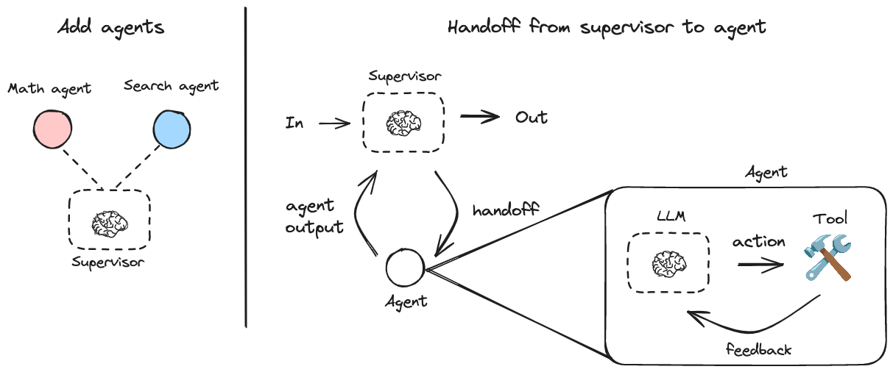
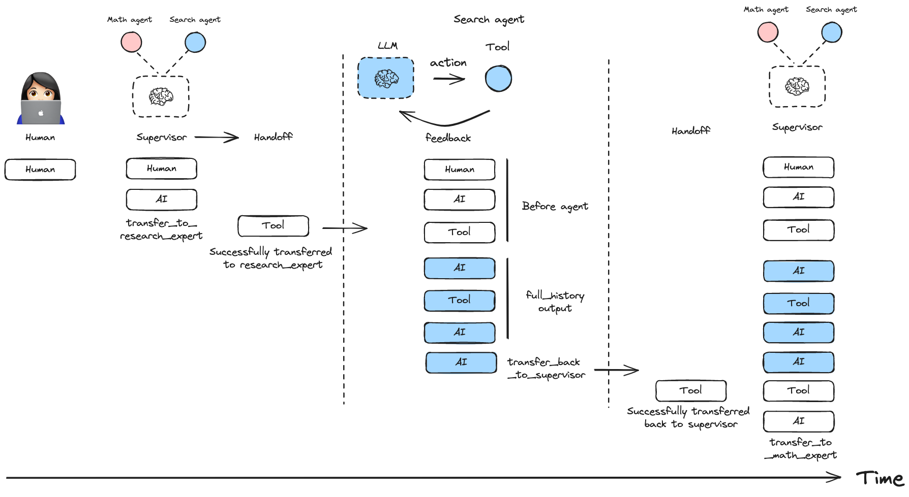
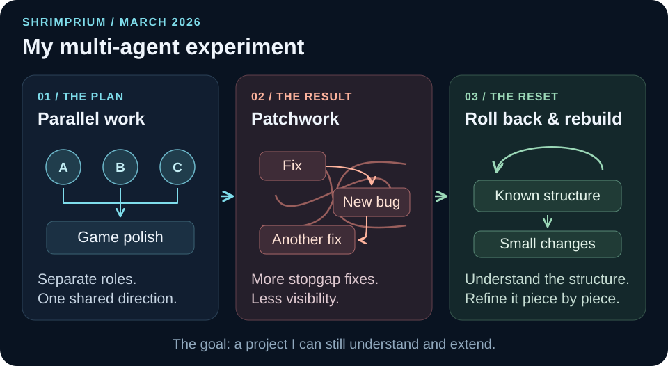

Hello, I'm Crafty Olive.

Last time I gave an overview of the engine. Recently I've been working on quests, achievements and other features that make the game feel more like a game.

During development, I assumed that implementing the core logic, heat, water quality and ecology, would be the hardest challenge. Once that stage was behind me, though, a completely different kind of difficulty emerged.

Building an engine and polishing it into an actual game look similar, but in practice they are quite different tasks. In other words, having features is one thing; making them connect naturally so that they are fun is another matter entirely.

Along the way, I also tried multi-agent automation using Claude Code and Antigravity. With the core engine largely in place, I expected the remaining cleanup and polish to go efficiently through automation.

I pictured several agents with separate roles working in parallel while I managed only the overall direction and the results. In today's development environment, that approach seemed entirely feasible, and I judged that for a project whose structure was already established, the remaining finishing work would suit automation especially well.

*A supervisor architecture as a conceptual reference. Source: [LangChain, LangGraph Multi-Agent Supervisor](https://github.com/langchain-ai/langgraph-supervisor-py/blob/da65ca50f41e1e0eda0827dae71d6b6f940bef4e/static/img/supervisor.png), © 2025 LangChain, Inc., [MIT License](https://github.com/langchain-ai/langgraph-supervisor-py/blob/da65ca50f41e1e0eda0827dae71d6b6f940bef4e/LICENSE). This illustrates a general pattern, not the setup used in my experiment.*

In practice, the results fell short of my expectations. More detailed specifications might have produced different results, and a clearer structure set out in advance might have made the automation more stable. Even so, the way things went once bugs started appearing was not good.

Rather than understanding and resolving each problem structurally, the agents often applied one stopgap fix after another just to block the error in front of them. Fixing one thing caused a new anomaly somewhere else, and as those were papered over in turn, the features kept working on the surface while the code underneath grew steadily more complex and unstable.

What worried me most was that I couldn't see enough of how the agents had done their work. I could check the results, but I couldn't fully control the reasoning and the path behind each change. For a simple, feature-driven project, that level of opacity might be acceptable. In a project where many pieces of logic are intertwined and a single small change can ripple through other parts, the uncertainty felt large. Changes piling up while I no longer fully understood the overall structure became a considerable burden in itself.

*An example of retaining an agent's full message history when control returns to the supervisor. Source: [LangChain, “Message History Management”](https://github.com/langchain-ai/langgraph-supervisor-py/blob/da65ca50f41e1e0eda0827dae71d6b6f940bef4e/static/img/full_history.png), © 2025 LangChain, Inc., [MIT License](https://github.com/langchain-ai/langgraph-supervisor-py/blob/da65ca50f41e1e0eda0827dae71d6b6f940bef4e/LICENSE). Reference example, not a record of my experiment.*

In the end, I rolled the project back to the point before I had started applying automation in earnest, and went back to refining the structure piece by piece. It may look like a step backward, but for now I judge it to be the more stable choice in the long run.

*My multi-agent experiment: parallel work, accumulating patches, then a return to a structure I could understand.*

I believe features have to be built on a structure I can understand myself if future expansion and maintenance are to go smoothly.

What I learned from this is that automation doesn't work wonders at every stage. AI and multi-agent systems are undeniably powerful tools and can be highly productive on repetitive or relatively independent tasks. But at the stage of working directly with a system's core logic and structure, it may be better for a person to stay closely involved and keep control of the context. At least in this project, multi-agent automation did not work as reliably as I had hoped.

I'm now continuing development by reorganizing the structure and refining the code one piece at a time. It may be somewhat slower, but I've regained the sense that I understand and control the whole, and I believe this approach will lead to a better finished product.

What matters to me is not simply building quickly, but leaving the project in a form that I can still understand and extend as time goes on. This experience showed me what automation can do, and it also made me rethink where to trust it and where to take hold of the work myself.
