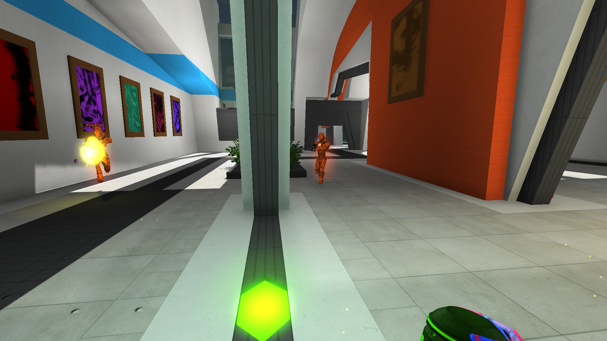
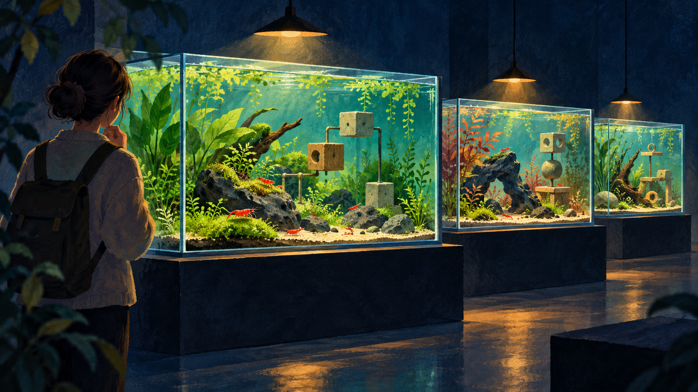

Hello, I'm Crafty Olive.

This time I've built Shrimprium's community features for the first time, and along the way the design took quite a big turn.

My original idea was a community where players drop into each other's rooms to watch shrimp tricks or play together. (Think of the rope tricks in Worms: the goal was to show off dazzling shrimp tricks to one another.)

If all players did was watch each other's tricks, real-time interaction between host and guest wouldn't matter much.

With the recent addition of the logic block system (on/off blocks, redstone blocks, piston blocks and so on), however, that assumption no longer held.

Guests would no longer just be watching; they would need to interact directly with the host's logic circuits. In other words, response time became a real issue.

A little lag wouldn't have hurt the experience much when people were simply watching. But if a shrimp pressed a button and the response came late, it would feel frustrating, and I expected it to produce many more bugs.

Two directions were possible.

The first was to build the community on real-time synchronization, improving response times between server and client the way RTS games do.

*Real-time interaction example: combat in Red Eclipse. Screenshot by TucanHolmes; game by the Red Eclipse Team. [Original and attribution](https://commons.wikimedia.org/wiki/File:Red_Eclipse_v2.0.0_Screenshot.png), [CC BY-SA 4.0](https://creativecommons.org/licenses/by-sa/4.0/). Shown uncropped; resized and converted to WebP for display.*

The second was to drop the idea of players' shrimp meeting each other directly, and instead have guests visit the host's tank and experience that space itself.

For a space-focused comparison, [Palia's official Home Tours description](https://palia.com/news/patch-182) explains how players submit a home plot and visitors explore an instanced version of it.

Put simply, it was a choice between a game where shrimp play together and a game where you visit someone else's tank to look around and try things out.

In the end, I chose the second.

The first reason was that interaction between shrimp turned out to be less fun than I had expected.

Exploring a tank someone else had made, trying out their contraptions and looking at their logic circuits, on the other hand, was far more enjoyable.

*AI-generated concept illustration of visiting player-built tanks and exploring their contraptions.*

The second reason was cost.

Shrimprium may look like a simple aquarium game, but a fairly heavy simulation runs underneath.

Handling all of the water quality, thermodynamics, ecosystem and logic block calculations on a real-time server would have been a much heavier burden than I had anticipated.

With the direction settled, I was still a little sad to let go of the real-time idea I had been excited about.

In a typical project with many developers, a change of course like this would probably have been very difficult.

But since I'm developing alone, in an environment where vibe coding lets me change things quickly, I was able to make a bold decision.

That doesn't mean I started from nothing. I reused the existing systems as much as possible, and by this point I had built up a much better feel for the project myself.

Where I once asked AI for something that felt "roughly like this," I can now give fairly specific instructions, down to the internal structure and implementation details, and get changes made quickly and accurately.

What I realized during this work is that even with vibe coding, working on a project for a long time gives you a developer's sense of your own. (I've also become quite good at using the right terms for each situation.)

I think my game is now genuinely fun. (Admittedly, that's a fairly subjective view.) Once it's reasonably complete, I plan to promote it in earnest. I'm laying the groundwork for that, too, and I'll share more when the opportunity comes.
