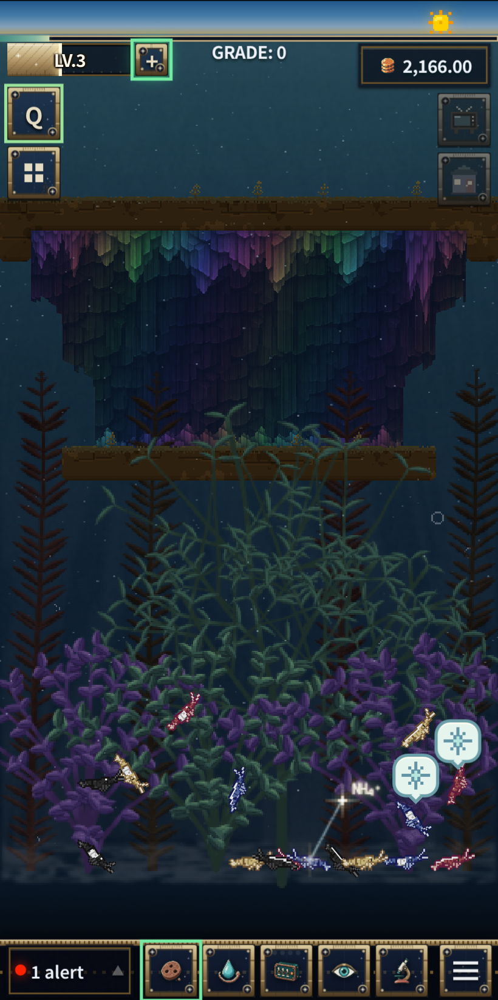
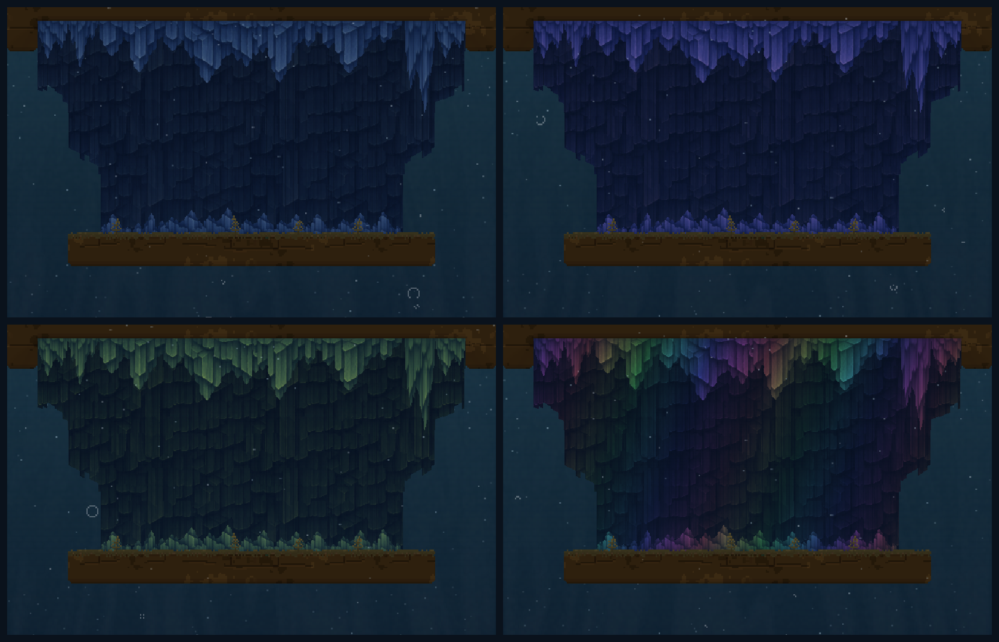
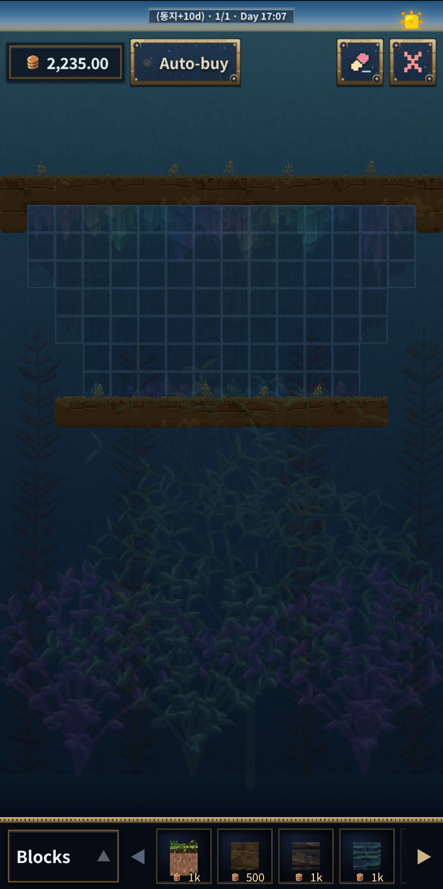

Hello, I'm Crafty Olive.

Most of last week went into moving the tank's rendering onto the GPU. With that settled, the past few days were a run of smaller changes. Here they are as a list.

## 1. Cave backdrops

- A new backdrop block that paints a cave behind the platform blocks. Shrimp swim straight through it.
- The cave shapes itself from its neighbours: stalactites grow under a block above, stalagmites grow on a block below, and three or more rows reveal a basalt wall inside.
- Four colours: the original blue, violet, lime and rainbow. Colour is chosen per cell, so different colours placed side by side still join into one cave. The rainbow one turns through the hues every six cells.
- They're sold in the background shop, with rainbow as the most expensive.

## 2. A rebuilt decorate mode

- Decorations are now picked by layer: backdrop, blocks, circuits, plants and objects. Only the chosen layer can be edited, and the others fade to 30%.
- The item list shows what's in the bag next to everything the shop sells, so you can place something you don't own yet and buy it on the spot.
- Buying asks first ("buy for N gold?"), and an auto-buy switch skips the question.
- Placed blocks, plants and objects are moved by dragging. A preview shows where they'll land, and they swap with whatever is already there.
- The toolbar was reorganised: gold and auto-buy on the left, eraser and exit on the right.
- While decorating, the moving effects (light rays, marine snow, plant sway, shrimp) rest so the layout is easier to see. Everything comes back when you leave.
- After decorating, the tank opens in viewing mode with the buttons hidden.

## 3. Water closer to a real tank

- The default tank is now 4 L instead of 1 L, with nitrifying bacteria rebalanced to match. Old saves are migrated automatically.
- pH no longer sits at a fixed 7.5. It drifts toward an equilibrium set by carbonate hardness, so it falls slowly as nitrification uses up the buffer and recovers after a carbonate dose.
- Nitrifiers grow more slowly, so a new tank takes about three weeks to cycle, as a real one does.
- Water-quality consumables (bacteria culture, carbonate powder, nitrate resin) are half price.

## 4. Births and twins

- The brooding wait after mating is gone. The birth button appears right away.
- Every birth now has a 10% chance of an extra baby. With the breeding assistant and no tank warnings, the chance rises to 20%, and it can go past the tank limit.
- The extra baby is a twin of the first: same colour, pattern and star grade, with only the gender picked separately.
- A twin birth gets its own reveal card with a rainbow border, a twin-bonus ribbon and a BONUS +1 stamp.

## 5. Quests and smaller fixes

- The first GRADE takes 30 points instead of 50, and the bacteria quest asks for 20% instead of 40%.
- Quest hints now lead you through the menu and inventory to the right item, and stop highlighting once a quest is ready to claim.
- Cleaner labels on the quest rewards and the house button.
- On phones that use WebGL2 instead of WebGPU, the cave, marine snow, light, floor and plants now draw into the same water canvas, and black water and stranded shrimp glows were fixed.
- Fixed shrimp freezing at the ends of a slide.
- I also tried connected platform terrain, then reverted it and returned to the 1.81 release. It needs more time before it's ready.
